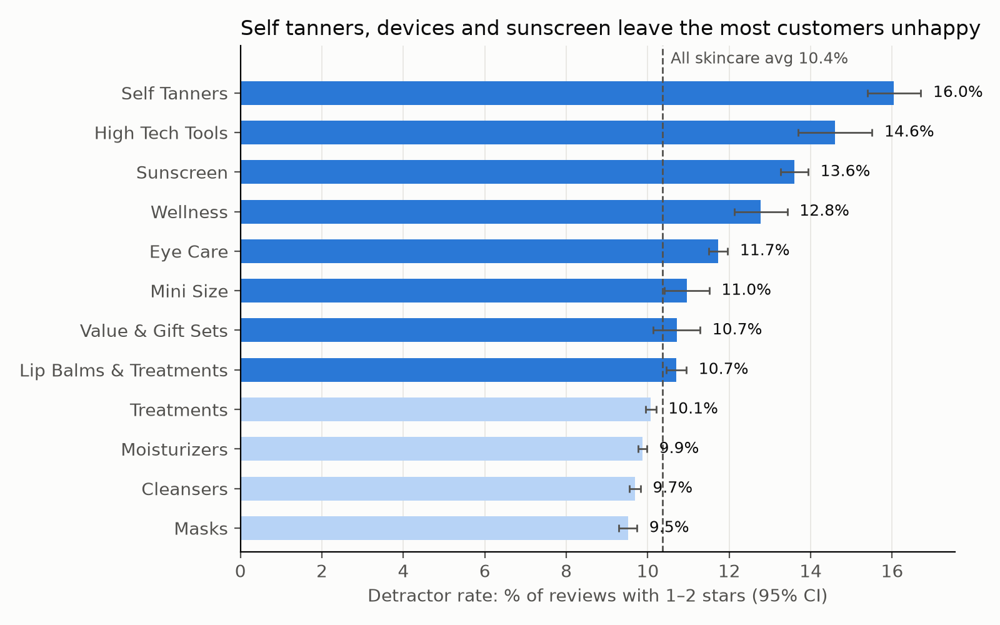

# Where Is Sephora Losing Skincare Customers?

Analysis of **971,390 Sephora skincare reviews** (2008–2023) to find where the assortment loses customer satisfaction, and what merchandising should do about it.

**[View the interactive Tableau dashboard](https://public.tableau.com/app/profile/rhiana.le/viz/WhereIsSephoraLosingSkincareCustomers/SephoraSkincareDashboard)**

## Key findings

| # | Finding | Recommendation |
|---|---|---|
| 1 | **Dissatisfaction is concentrated.** Self tanners (16.0%), high-tech tools (14.6%) and sunscreen (13.6%) have 40–70% more 1–2 star reviews than core categories (~10%). | Fix each by its cause: fit (tanners), product (sunscreen), value (devices) |
| 2 | **Sunscreen hides a skin-tone problem.** Unhappy deep-skin buyers cite white cast 2.5x more than fair-skin buyers (37% vs. 14.5%), and only ~6.5% of reviews come from tan-to-dark skin tones. | Add a "sheer on deep skin" tag and skin-tone review filters |
| 3 | **Price buys satisfaction only in some categories.** Each doubling of price ≈ 14% lower odds of a detractor review (logistic regression), strong for cleansers and eye care, flat for moisturizers. | Grow budget moisturizers; screen budget eye care harder |

KPI used throughout: **detractor rate** = share of reviews with 1–2 stars. (Stars and "would recommend" correlate at r = 0.97, so one KPI is enough.)

## Repository contents

| File | What it does |
|---|---|
| `01_data_profiling_and_q1.ipynb` | Data profiling, cleaning (removes 22% syndicated duplicate reviews), KPI choice, where dissatisfaction concentrates and why |
| `02_segments_and_price.ipynb` | Skin type and skin tone segments, sunscreen white cast, price vs. satisfaction (within-category comparison + logistic regression) |
| `tableau/` | Tableau workbook and the summarized data it uses |
| `fig_*.png` | Charts exported from the notebooks |
| `requirements.txt` | Python libraries needed |

## How to reproduce

1. Download the [Sephora Products and Skincare Reviews](https://www.kaggle.com/datasets/nadyinky/sephora-products-and-skincare-reviews) dataset from Kaggle and unzip it into a folder named `archive/` next to the notebooks.
2. Install the libraries: `pip install -r requirements.txt`
3. Run `01_data_profiling_and_q1.ipynb` first (it writes `reviews_clean.parquet`), then `02_segments_and_price.ipynb`.

The raw data is not included in this repository because of its size (~520 MB).

## Methods and tools

Python (pandas, NumPy, statsmodels, matplotlib), Jupyter, Tableau. Every number on the dashboard was cross-checked against the notebook results.

## Limitations

Reviewers self-select and self-report skin type and tone; complaint themes use keyword matching (directional, not exact); price effects are associations, not causal estimates.

---

**Rhiana Le** · M.S. Business Analytics, Cal Poly Pomona · [LinkedIn](https://www.linkedin.com/in/lethanhthuyvy)
